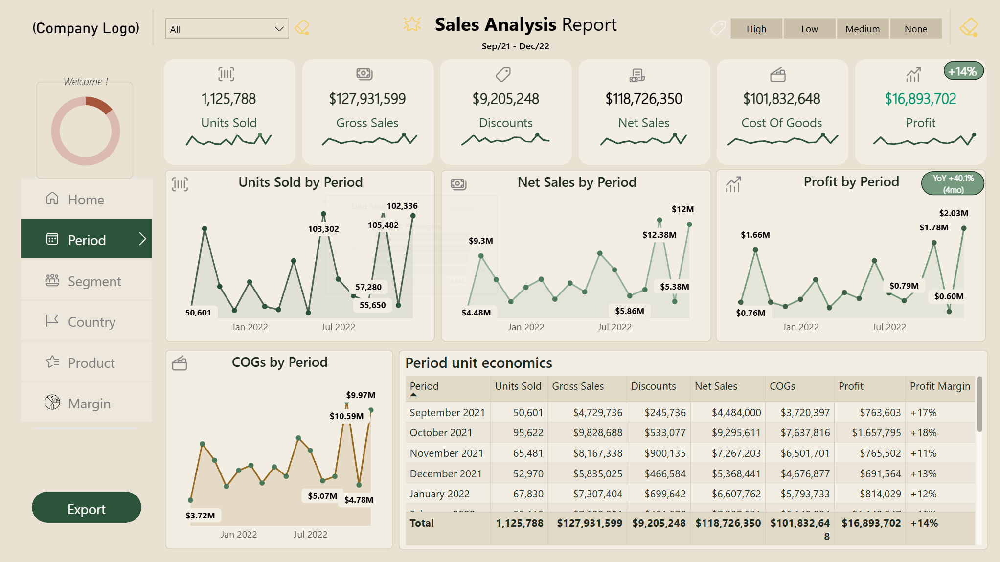
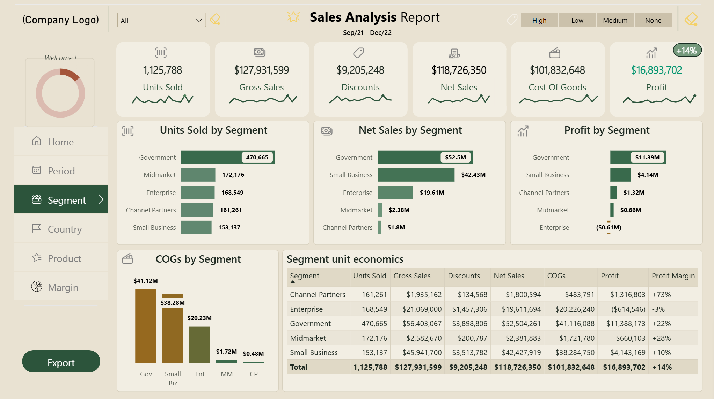
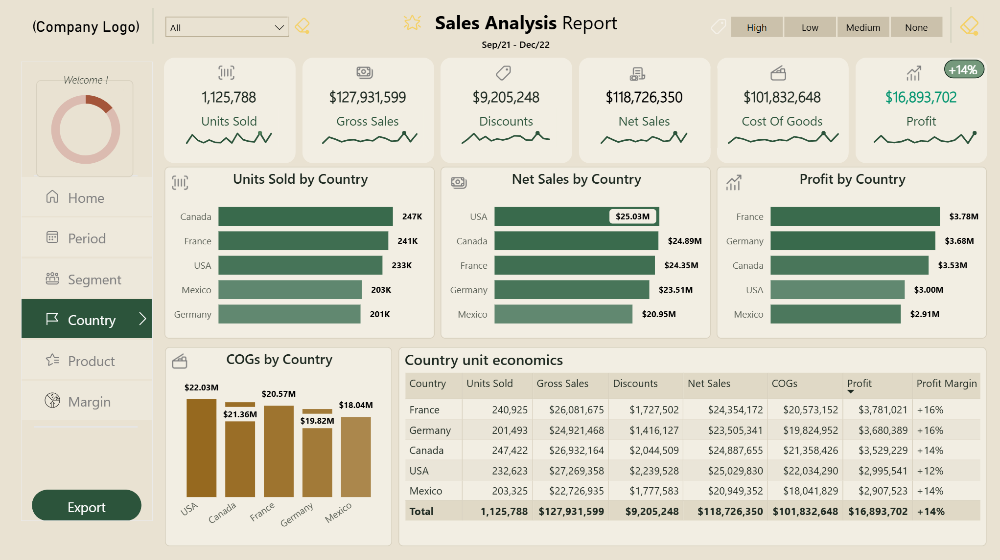
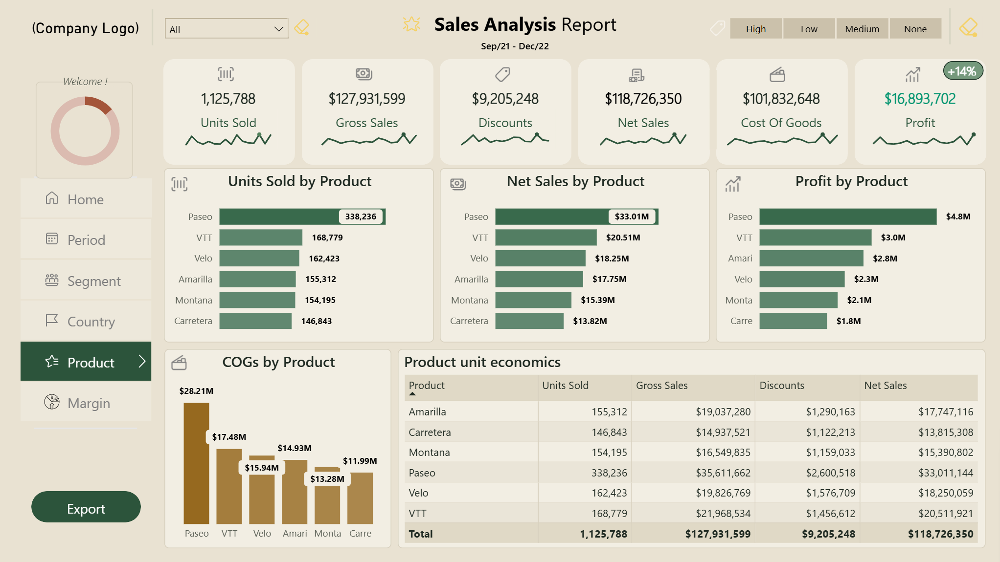
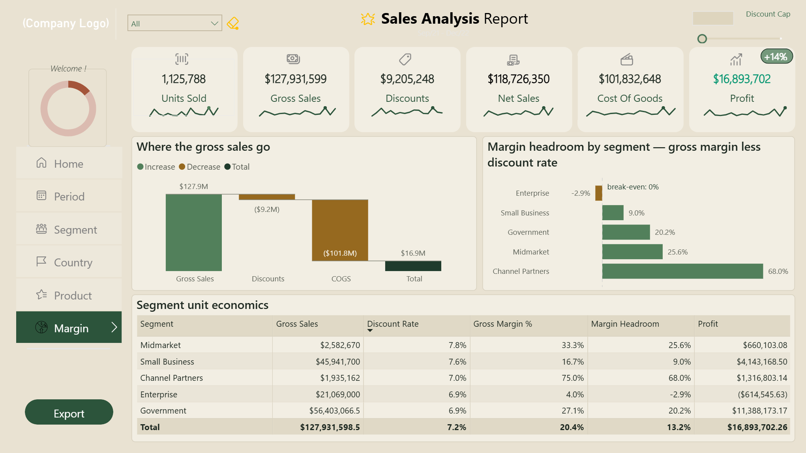

# 📈 Sales Analytics Report

### **$118.7M in net sales. Just $16.9M in profit. Where does the revenue go?**

An interactive Power BI report investigating the gap between sales and profit—revealing the impact of cost of goods sold, discounts, and segment-level performance on profitability.

`Power BI` · `DAX` · `Power Query` · `Sales Analytics`

---

## 🧩 The Business Problem

**High revenue does not automatically translate into high profit.**

The business records $118.73M in net sales but retains $16.89M in profit. With $101.83M in cost of goods sold (COGS), understanding cost structure and differences in segment profitability is essential to identifying opportunities for improvement.

This report helps decision-makers explore:

- How sales and profit change over time.
- Which business segments contribute most to total profit.
- Where sales are concentrated geographically and by product.
- How discounts and cost structure relate to profitability.

**Built for:** Sales leaders · Commercial managers · Finance teams · Business owners

---

## 📊 At a Glance

| Net Sales | Net Profit | Profit Margin | Units Sold |
|---:|---:|---:|---:|
| **$118.73M** | **$16.89M** | **14.2%** | **1.13M** |

700 sales records · 16 months · 5 segments · 5 countries · 6 products

### Where the revenue goes

| Financial measure | Amount |
|---|---:|
| Gross Sales | $127.93M |
| Discounts | −$9.21M |
| **Net Sales** | **$118.73M** |
| Cost of Goods Sold | −$101.83M |
| **Net Profit** | **$16.89M** |

COGS represents approximately **85.8% of net sales**, while the net profit margin is **14.2%**. These figures highlight where further investigation into costs and segment economics may be valuable.

---

## 🖼️ Explore the Report

### 1 · Home — *The executive starting point*

**$127.9M gross sales → $118.7M net sales → $16.9M profit.** An executive landing page with financial highlights and direct navigation to the analysis.

### 2 · Period — *When does performance change?*

Explore monthly sales and profit performance. Interpret apparent spikes cautiously: changes in record counts may influence the pattern.

### 3 · Segment — *Who contributes to profit?*

**Government contributes approximately 67% of total profit.** Compare segment contribution and profitability to distinguish profit drivers from high-margin segments.

### 4 · Country — *Where are sales concentrated?*

**USA leads net sales at $25.03M, while France leads profit at $3.78M.** Canada records the highest unit sales at 247K, showing why revenue, volume, and profitability should be evaluated separately.

### 5 · Product

**Paseo leads net sales ($33.01M), units sold (338K), and profit ($4.8M).** VTT ranks second across all three measures, with $20.51M in net sales, 168K units sold, and $3.0M in profit.

### 6 · Margin — Profitability Analysis

**Enterprise records approximately $614.5K in losses at a −2.9% net margin.** Examine segment-level margins and discount patterns to identify where commercial performance needs further investigation.

*Period, Segment, Country, and Product are bookmark-driven views on a shared Sales Analysis canvas.*

---

## 💡 Insights & Recommendations

The analysis highlights where profit is generated, where losses occur, and where further investigation could support better commercial decisions.

| Insight | Evidence | Recommendation |
|---|---|---|
| **COGS is the largest deduction** | $101.83M in COGS consumes approximately 85.8% of net sales. | Investigate cost drivers, unit economics, and opportunities to improve gross profitability. |
| **Profit is concentrated in key segments** | Government contributes approximately 67% of total profit; Small Business contributes around 24%. | Understand the pricing, cost, and sales factors behind these contributions before prioritizing growth. |
| **Enterprise is loss-making** | Approximately −$614.5K in profit and a −2.9% net margin. | Review pricing, discounts, and cost-to-serve to identify the drivers of negative profitability. |
| **Discounts reduce realized revenue** | $9.21M separates gross sales from net sales. | Evaluate discount policies against their effect on net sales and profit—not revenue alone. |
| **High margin does not guarantee high contribution** | Channel Partners has approximately 73% margin but contributes around 8% of total profit. | Consider both profit margin and total profit contribution when allocating commercial resources. |
| **Monthly patterns require validation** | Revenue and record count have a strong correlation (**r = 0.871**); only 16 monthly observations are available. | Validate reporting volume and data consistency before drawing conclusions about demand or seasonality. |
| **Product profitability needs better cost data** | The source cost structure does not reliably support product-level profit and margin calculations. | Validate product-level costs before making product pricing or portfolio decisions based on profitability. |

**Management takeaway:** Focus on profitable growth. Investigate the cost structure, understand why Enterprise generates losses, and evaluate discounts alongside their impact on net profit.

---

## ⚠️ Limitations

- **Sample data:** Results do not represent an actual company's performance.
- **Short history:** Sixteen monthly observations are insufficient to establish reliable seasonality.
- **Cost inconsistency:** Product-level profit and margin are excluded.
- **No customer key:** Customer-level analysis is unavailable.
- **Limited causal evidence:** The report identifies patterns but cannot establish why a segment is profitable or loss-making.

See [Known Limitations](KNOWN_LIMITATIONS.md) and [Data Validation](DATA_VALIDATION.md).

---

## ✅ Data Validation

Headline figures reconcile to the source workbook.

| Reconciliation | Result |
|---|---:|
| Gross Sales − Discounts | $118.73M Net Sales |
| Net Sales − COGS | $16.89M Net Profit |
| Net Profit ÷ Net Sales | 14.2% Profit Margin |

Values are rounded for display. See [Data Validation](DATA_VALIDATION.md) for the supporting methodology.

---

## 🚀 How to Use

**Read it** — the six screenshots above show the report's main views. No installation is required to review them.

**Open it** — download [`Sales_Analysis_Report.pbix`](report/Sales_Analysis_Report.pbix) and open it in Power BI Desktop. If the source file path has changed, update the data source to the repository's `data/Sales_Dataset.xlsx` workbook, then refresh and validate the headline figures.

**Understand it** — review the documentation for metric logic, data structure, analytical methodology, and implementation details.

**Explore the documentation:**

- [Project Overview](PROJECT_OVERVIEW.md)
- [Metric Definitions](METRIC_DEFINITIONS.md)
- [Data Dictionary](DATA_DICTIONARY.md)
- [Methodology](METHODOLOGY.md)
- [Data Validation](DATA_VALIDATION.md)
- [Known Limitations](KNOWN_LIMITATIONS.md)
- [Design System](DESIGN_SYSTEM.md)
- [Implementation SOP](IMPLEMENTATION_SOP.md)
- [GitHub Release Checklist](GITHUB_RELEASE_CHECKLIST.md)

---

## 📁 Repository Structure

| Resource | Contents |
|---|---|
| [`report/`](report/) | Power BI report |
| [`data/`](data/) | Source workbook, if approved for public distribution |
| [`docs/images/`](docs/images/) | Report screenshots |
| [`PROJECT_OVERVIEW.md`](PROJECT_OVERVIEW.md) | Business problem and scope |
| [`METRIC_DEFINITIONS.md`](METRIC_DEFINITIONS.md) | Metric definitions |
| [`DATA_DICTIONARY.md`](DATA_DICTIONARY.md) | Tables and columns |
| [`METHODOLOGY.md`](METHODOLOGY.md) | Analytical approach |
| [`DATA_VALIDATION.md`](DATA_VALIDATION.md) | Reconciliation evidence |
| [`KNOWN_LIMITATIONS.md`](KNOWN_LIMITATIONS.md) | Data and analytical limitations |
| [`DESIGN_SYSTEM.md`](DESIGN_SYSTEM.md) | Visual design standards |
| [`IMPLEMENTATION_SOP.md`](IMPLEMENTATION_SOP.md) | Build instructions |
| [`GITHUB_RELEASE_CHECKLIST.md`](GITHUB_RELEASE_CHECKLIST.md) | Release checklist |

---

## 🛠️ Built With

- Microsoft Power BI Desktop
- DAX
- Power Query
- Microsoft Excel
- GitHub

---

## 👤 Author

**Yisak Fikre** — Microsoft Certified Data Analyst · Power BI Developer

               

**More projects:**

- [SaaS Growth & Unit Economics](https://github.com/yisakfikre/SaaS-Growth-and-Unit-Economics)
- [Marketing Campaign Performance](https://github.com/yisakfikre/Marketing-Campaign-Performance-Report)
- [Gross Margin Bridge](https://github.com/yisakfikre/Gross-Margin-Bridge-Report)

---

## 📜 Licence

**MIT** for code · **CC BY 4.0** for data and documentation. See [LICENSE](LICENSE). No font binary, icon set or third-party component is redistributed.